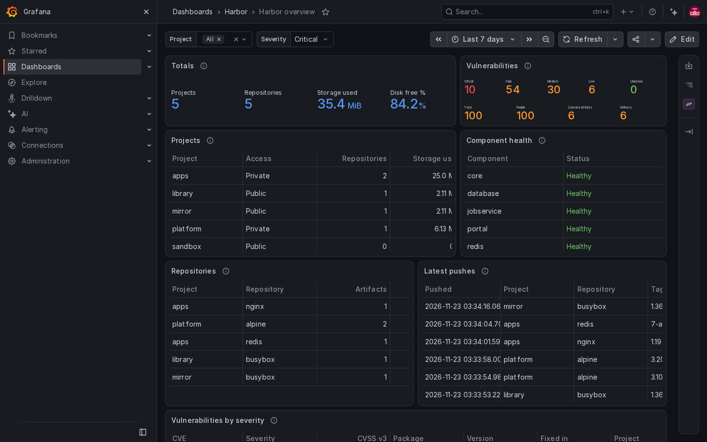

# Harbor data source for Grafana

Shows what a [Harbor](https://goharbor.io) container registry holds and how it
is doing, in Grafana dashboards and alerts: projects and their storage quotas,
repositories, images and other artifacts, vulnerabilities, replication and
garbage collection runs, the audit log, job queues and the health of Harbor's
components.

The plugin only reads. It talks to the Harbor API from the Grafana server, so
browsers never see the Harbor password.



## Requirements

- Grafana 13.2 or later.
- Harbor 2 with the v2.0 API. The plugin is developed and tested against
  **Harbor 2.15**. See [Known limitations](#known-limitations) for older
  versions.
- A Harbor account for Grafana, preferably a robot account (see below).

## Configuration

Add a data source of type **Harbor** and fill in:

| Setting             | What to enter                                                                                                                                                                       |
| ------------------- | ----------------------------------------------------------------------------------------------------------------------------------------------------------------------------------- |
| URL                 | The address you open Harbor at in a browser: `https://harbor.example.com`                                                                                                           |
| User name, Password | A robot account, with its full name such as `robot$grafana` as the user name and its secret as the password. A Harbor user works too. Leave both empty to read public projects only |
| TLS                 | A custom CA certificate, a client certificate, or (for testing only) no certificate verification                                                                                    |
| Query timeout       | How long one panel query may take, 30 seconds by default                                                                                                                            |

**Save & test** connects, says which Harbor version answered and how many
projects the account can see, and lists anything the account is not allowed to
read.

### The robot account

In Harbor, open **Administration > Robot Accounts** and create a system robot
account with the permissions for what you want to query. None of them lets
Grafana change anything.

| Permission                                  | Under                                                  | Needed for                                                                                     |
| ------------------------------------------- | ------------------------------------------------------ | ---------------------------------------------------------------------------------------------- |
| Project: List                               | System                                                 | Everything: the list of projects                                                               |
| Repository: List, Artifact: List, Tag: List | Project (all projects, or the ones Grafana should see) | Repositories and artifacts                                                                     |
| Quota: List                                 | System                                                 | Storage used and quotas of projects, and the storage total. Without it those columns are blank |
| System volumes: Read                        | System                                                 | The size and free space of the registry's disk                                                 |
| Security hub: List, Read                    | System                                                 | Vulnerabilities and vulnerability totals                                                       |
| Replication: List, Replication policy: List | System                                                 | Replications                                                                                   |
| Garbage collection: List                    | System                                                 | Garbage collection                                                                             |
| Audit log: List                             | System                                                 | Audit log                                                                                      |
| Jobservice monitor: List                    | System                                                 | Job queues                                                                                     |
| Robot account: List                         | System                                                 | Robot accounts                                                                                 |

A query that needs a permission the account lacks fails with a message that
names the permission. Health needs none.

A user with the system administrator role can read everything, but a robot
account with only these permissions is the safer choice.

### Grafana Cloud and a private Harbor

Grafana Cloud cannot reach a Harbor on a private network directly. Set up
[Private data source connect](https://grafana.com/docs/grafana-cloud/connect-externally-hosted/private-data-source-connect/)
and choose the connection under **Private network** in the data source
settings. In a Grafana you host yourself the section appears when the secure
socks proxy is enabled in Grafana's configuration.

### Provisioning

Grafana expands `$name` in provisioning files as an environment variable, so
write the dollar sign of a robot account's name twice:

```yaml
apiVersion: 1
datasources:
  - name: Harbor
    type: smartquinoa1504-harbor-datasource
    access: proxy
    url: https://harbor.example.com
    jsonData:
      username: robot$$grafana
      timeoutSeconds: 30
    secureJsonData:
      password: $HARBOR_ROBOT_SECRET
```

## Queries

Choose what to ask for in the **Query** field.

| Query                | Returns                                                                                                                         | Good for                                              |
| -------------------- | ------------------------------------------------------------------------------------------------------------------------------- | ----------------------------------------------------- |
| Projects             | One row per project: public or private, repositories, storage used, quota and the share of it in use. Or one number per project | Tables, bar gauges; an alert on a quota that fills up |
| Repositories         | One row per repository: artifacts, pulls, last update                                                                           | Tables: most pulled, never updated                    |
| Artifacts            | One row per image or other artifact: tags, size, push and last pull time, scan result with counts by severity                   | Tables, annotations for pushes                        |
| Vulnerabilities      | One row per finding: CVE, severity, CVSS score, package, installed and fixed version, where it was found                        | Tables: what to patch first                           |
| Vulnerability totals | Findings by severity, fixable findings, and scanned and total artifacts                                                         | Stats; an alert on critical findings                  |
| Totals               | Projects, repositories, storage used, and the size and free space of the registry's disk                                        | Stats; an alert on free disk space                    |
| Health               | Harbor's components with their status. Or one number per component: 1 for healthy, 0 for not                                    | Tables; an alert on an unhealthy component            |
| Replications         | Runs of replication rules: status, trigger, duration, tasks that succeeded and failed                                           | Tables; spotting failed runs                          |
| Garbage collection   | Runs of garbage collection: status, duration, space freed, blobs and manifests removed                                          | Tables                                                |
| Audit log            | Who did what, in the time range of the dashboard                                                                                | Tables, logs, annotations                             |
| Job queues           | Jobs waiting for each kind of background job, and how long the oldest has waited                                                | Tables; an alert on a queue that grows                |
| Robot accounts       | System robot accounts: enabled or not, expiry date, days left                                                                   | Tables; spotting accounts about to expire             |

### Projects, repositories and artifacts

- **Projects**: leave empty for every project, or choose some. Artifacts need
  at least one.
- **Repositories** can be narrowed to names that contain a text, sorted by
  name, pulls, artifacts or last update, and limited.
- **Artifacts** lists one repository, or every repository of the chosen
  projects, newest push first. With several projects or large ones, name a
  repository: the plugin asks Harbor for the artifacts of each repository in
  turn, for at most 200 repositories per query.
- **Limit** decides how many rows you get when there are more (100 by
  default, at most 10,000). The editor says when rows were left out.

### Vulnerabilities

The findings come from Harbor's security hub, which needs a vulnerability
scanner (Trivy is the one Harbor ships with) and scanned artifacts. Narrow
them by project, repository (by its full name, such as `library/nginx`),
severity, CVE id or package name. Harbor matches these exactly: `openssl` does
not find `libssl`.

### Numbers for alert rules, stats and gauges

Tables are for reading. An alert rule needs one number per thing it watches,
so several queries can return that instead:

- **Projects**, **Job queues** and **Health** have a **Show** option that
  turns the table into one number per project, job type or component.
- **Vulnerability totals** and **Totals** return every number by default; the
  **Number** option keeps one of them.

### Audit log

The audit log is the one query that follows the dashboard's time range. Narrow
it by user, operation (`create`, `delete`, `pull`, `push` and others) or
resource type (`artifact`, `project`, `user`, `robot` and others), which
Harbor matches exactly.

## Template variables

A variable of type **Query** can list **projects**, or **repositories**
(optionally of one project, which can be another variable such as `$project`).
Use a variable by choosing it in a query's Projects or Repository field. A
projects variable set to several values or to "All" selects all of them.

## Annotations

Add an annotation query and choose the **Audit log** query, for example with
the operation `delete`, or the **Artifacts** query for a project: each entry
or push is marked at its time.

## Alerting

Queries run on the Grafana server, so they work in alert rules. Typical rules:

- **Health** with **Show** set to _Healthy (1 or 0)_, reduced with "last",
  below 1. The rule gets one instance per component, labelled `component`.
- **Projects** with **Show** set to _Quota used %_, reduced with "last",
  above 90. One instance per project that has a quota, labelled `project`.
- **Vulnerability totals** with **Number** set to _Critical_, reduced with
  "last", above 0.
- **Totals** with **Number** set to _Disk free %_, reduced with "last",
  below 10.

## Security

- The password is stored encrypted by Grafana and sent only from the Grafana
  server to Harbor. Use an `https://` URL: the settings page warns when a
  password would be sent over plain HTTP.
- Use a dedicated robot account with only the read permissions listed above.
- Everyone who can query the data source sees what its Harbor account can see,
  including the names of private projects, their images and their
  vulnerabilities, and the audit log if the account may read it.

## Known limitations

- Tested against Harbor 2.15 only. The security hub (vulnerabilities and
  their totals) arrived in Harbor 2.9; on older versions those two queries
  fail. Before Harbor 2.13 the audit log lives at another address, which the
  plugin falls back to, but that path is not tested against a real server.
- Harbor has no history for most of what it reports. Apart from the audit log
  and the lists of replication and garbage collection runs, every query
  returns the current state. To chart a number over time, record it with a
  Grafana recording rule, or scrape Harbor's own Prometheus metrics.
- Totals are added up from what the account can see. A robot account that
  sees only some projects gets the totals of those.
- Harbor's filters match exactly, so there is no search by part of a CVE id
  or package name.
- With a wrong password Harbor still shows its public projects on some
  addresses. **Save & test** detects a rejected login; a panel of a data
  source whose password has since stopped working may show only public
  projects instead of an error.
- Proxy cache projects, labels, tag retention, webhooks and scan schedules
  are not covered.

## Feedback and contributing

Report problems and ideas in the
[issue tracker](https://github.com/Sam-H101/grafana-harbor-datasource/issues).
[CONTRIBUTING.md](https://github.com/Sam-H101/grafana-harbor-datasource/blob/master/CONTRIBUTING.md)
describes how to build and test the plugin.

This plugin is not made or endorsed by the Harbor project. Harbor is a
trademark of The Linux Foundation.

## Licence

Apache-2.0.
